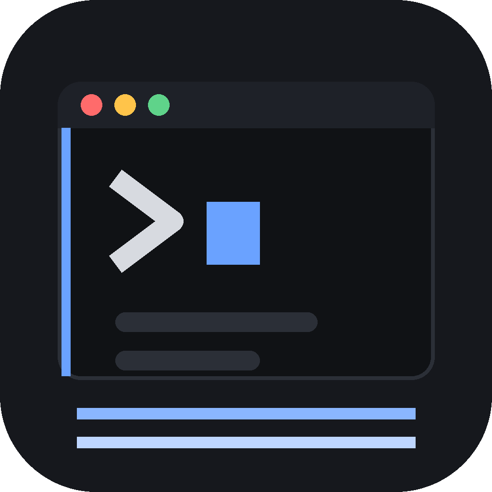
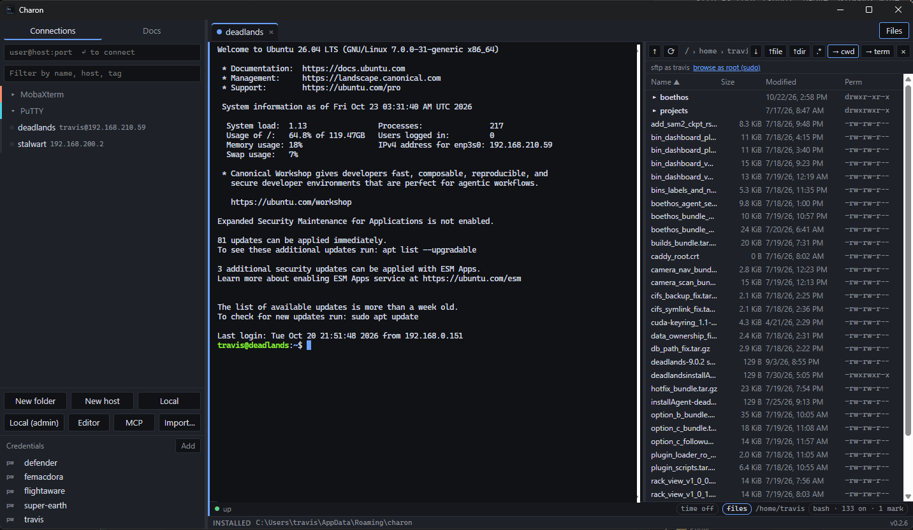
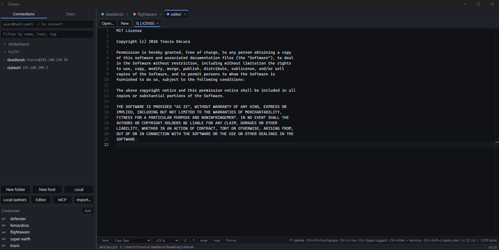
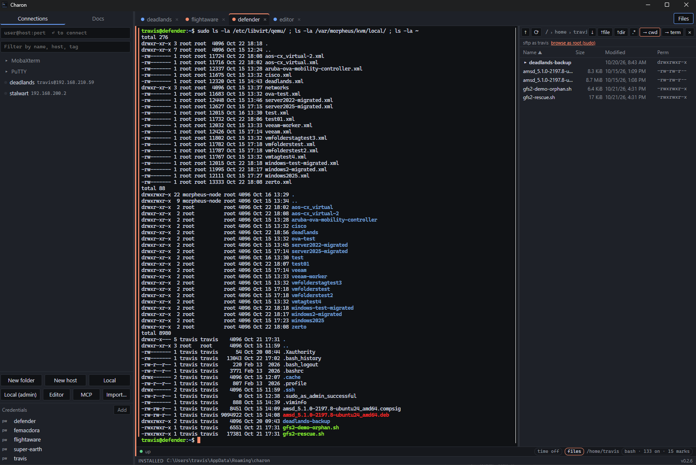
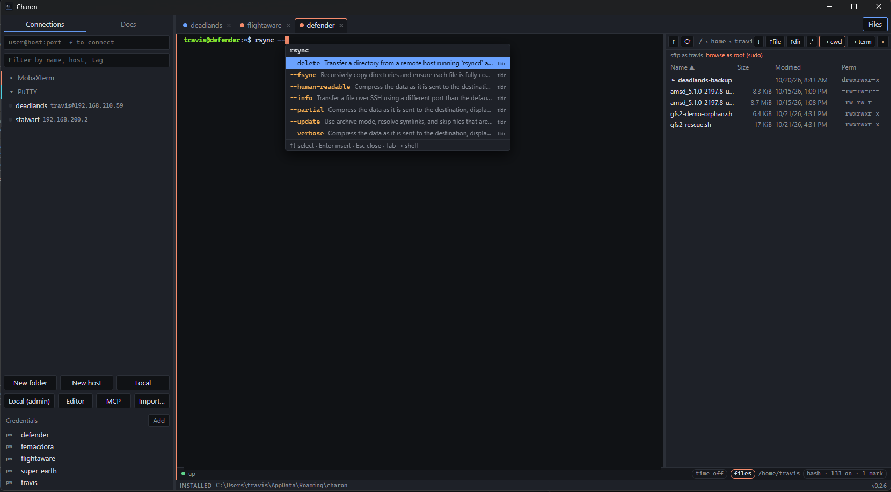
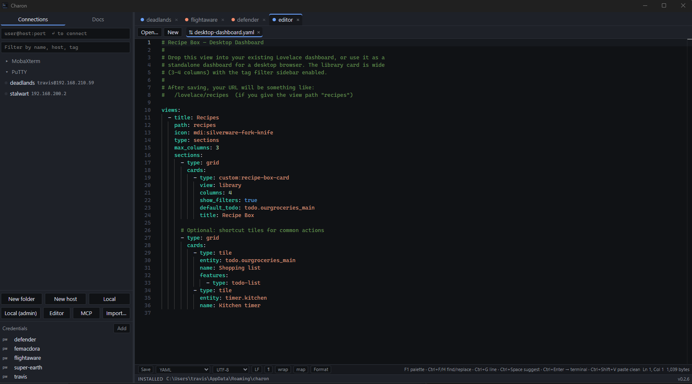
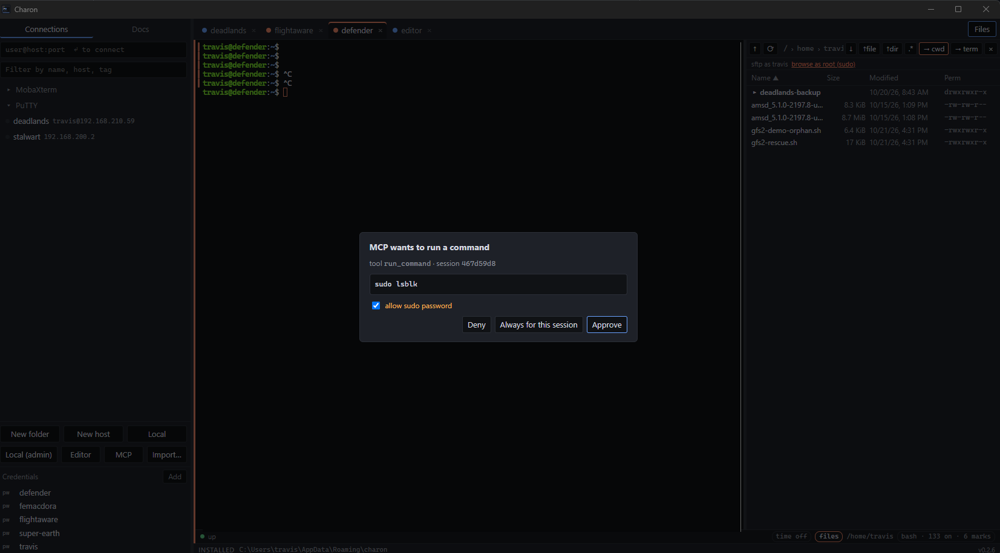

  

<h1 align="center">Charon</h1>

  Terminal, connection manager, SFTP, editor and an MCP bridge for AI agents — in one app. 
  Portable on Windows. deb/rpm/AppImage on Linux. dmg on macOS.

  <a href="https://github.com/builtbyfood/charon/releases/latest">Download</a> ·
  <a href="docs/BUILDING.md">Build from source</a> ·
  <a href="CHANGELOG.md">Changelog</a>

<!-- screenshot: main window — connection tree on the left with a colored folder, an SSH tab
     with a few command marks in the gutter (one red), Files pane on the right showing the
     "sftp as root (sudo)" badge. ~1600px wide, dark theme. -->

---

Charon replaces the PuTTY + MobaXterm + Notepad++ stack for people who spend their day on
other machines. It's built around the things those tools never quite did together: a tree
of hosts that inherit settings from their folders, a terminal that knows where each command
starts and ends, a file pane that follows your shell (even after `sudo -i`), an editor that
saves straight back over SFTP, and a way to let an AI agent work in a real session without
handing it the keys.

Single Rust + Tauri codebase. No Electron, no Java, no bundled Cygwin.

## Highlights

**Connection tree with inheritance.** Folders carry user, credential, jump host, color,
tags and startup commands; hosts inside inherit them. Set a bastion on the `prod` folder
once. Import from `~/.ssh/config`, PuTTY (registry or files) and MobaXterm `.mxtsessions`,
with a duplicate preview before anything is written. `.ppk` keys are read natively.

<!-- screenshot: sidebar with two folders expanded, inherited color dots, and the host
     editor open showing greyed "inherit: travis" placeholders. ~900px wide. -->

**Command-aware terminal.** A small shell hook (bash, zsh, fish, PowerShell — injected on
connect, never written to the remote's rc files) marks every prompt, command and exit code.
You get a gutter bar per command, red on failure; Ctrl+↑/↓ to jump between commands;
Ctrl+Shift+↑ to select just the output; *Copy last output* on the context menu. `sudo -i`
re-injects automatically.

<!-- screenshot: terminal close-up — three commands with gutter bars, the middle one red,
     status-bar chip reading "bash · 133 on · 3 marks". ~1000px wide. -->

**Clean copy and paste.** Copying strips zero-width characters, NBSPs, BOMs, trailing
whitespace and smart quotes. Pasting warns on multi-line or hidden-character content with
an inline bar (never a modal), and runs bracketed pastes without an extra Enter.
MobaXterm-style right-click: copy with a selection, paste without.

**Flag hints and docs.** Type `tar --` and a popup lists tar's options with descriptions,
from bundled tldr pages plus the host's own `--help`. The Docs panel shows the tldr page for
whatever you're typing and fetches real man pages over the session.

<!-- screenshot: the flag picker open under "rsync --" with ~8 options visible. ~800px wide. -->

**Files that follow you.** The SFTP pane opens with every tab and tracks the shell's
directory (or drives it — both directions). After `sudo -i` it notices it can't read `/root`
and quietly runs a second SFTP server through `sudo` on the same connection, so root
browsing and transfers are full-speed SFTP. Multi-select, recursive directory transfers
with per-file progress, drag-drop, preserve-mode.

**Editor with remote save-back.** Monaco (the VS Code engine) with Notepad++ habits:
inner document tabs, encoding and line-ending conversion in the status bar, show-all
characters, regex find/replace, snippets, Ctrl+Enter to send a line to the terminal.
Remote files save atomically over SFTP.

<!-- screenshot: editor tab with a YAML file open, status bar showing "UTF-8 · LF · yaml",
     inner tabs for two documents. ~1000px wide. -->

**MCP server for agents.** Enable it and point Claude Code, Cursor or any MCP client at
Charon. Every host has a tier: `read` (list sessions, read scrollback), `exec-approve`
(each command pops an Approve/Deny dialog showing it verbatim; 60 s silence = deny),
or `trusted`. Sudo is a separate explicit grant. The server binds to localhost with a
per-launch token; the log records decisions, never command text.

<!-- screenshot: the MCP approval dialog over a terminal, showing "sudo systemctl restart
     nginx" with Approve / Deny and the "allow sudo password" checkbox. ~700px wide. -->

**Sudo button.** When `[sudo] password for you:` appears and the session has a stored
credential, a button in the status bar (or Ctrl+Shift+P) sends it — never echoed, never
logged. Auto-send is opt-in and only ever answers your own user's sudo prompt.

**Portable.** Drop `portable.flag` next to the binary and everything — config, vault,
known hosts, even the webview profile — lives in a `data/` folder beside it. Nothing
touches AppData or `~/.config`. Credentials are in an `age`-encrypted vault with a master
password (installed mode uses the OS keyring instead).

## Install

| Platform | Get it |
|----------|--------|
| Windows 10/11 | `charon-windows-portable.zip` (unzip and run) or `Charon_x.y.z_x64-setup.exe` |
| Debian / Ubuntu 22.04+ | `sudo apt install ./charon_x.y.z_amd64.deb` |
| Fedora / RHEL 9 family | `sudo dnf install ./charon-x.y.z-1.x86_64.rpm` |
| Other Linux | `Charon_x.y.z_amd64.AppImage` or `charon-linux-portable.tar.gz` |
| macOS | `Charon_x.y.z_aarch64.dmg` (Apple Silicon) or `Charon_x.y.z_x64.dmg` (Intel) — unsigned, see below |

All from the [latest release](https://github.com/builtbyfood/charon/releases/latest).

macOS builds are unsigned for now: on first launch right-click → Open, or run
`xattr -d com.apple.quarantine /Applications/Charon.app`.

One warning that saves an hour on Windows: don't run an elevated Charon alongside a normal
one. They share a WebView2 profile and the non-elevated copy stops receiving keystrokes.
Portable mode avoids this; installed mode doesn't.

## Status

Charon is a preview. It's in daily use on the maintainer's machines against Ubuntu, Fedora
and RHEL hosts, and it's ready for other people to break. The [tester guide](docs/TESTING.md)
walks through every feature with the things worth trying on purpose, and §10 says what to
include in a report so it's diagnosable (Charon logs its decisions to the devtools console
with a `[charon]` prefix — Ctrl+Shift+I).

Not yet: RDP/VNC in a tab, editor language servers, signed macOS builds, serial has had
little real-hardware time. See [ROUND3](docs/ROUND3.md) for what's next.

## Building

Rust stable, Node 22, and Tauri 2's platform deps. `npm install && npm run tauri dev` for
the dev loop, `npm run tauri build` to bundle for the current OS, `npm run portable` for a
portable build. Full details, including the Linux package lists and the CI pipeline, in
[docs/BUILDING.md](docs/BUILDING.md).

## Security

Charon stores credentials and can run commands on your behalf. If you find a vulnerability,
please read [SECURITY.md](SECURITY.md) rather than opening a public issue.

## License

Apache-2.0. Named for the ferryman — it gets you across to the other machine.
